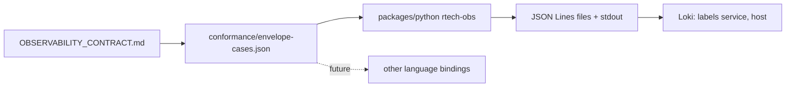

# rtech-standards

A cross-language logging standard: one JSON log envelope, a conformance
fixture that proves an implementation follows it, and a Python reference
package.

> Portfolio piece. Source shown for review only; not licensed for use. See LICENSE.

## What it does

- `OBSERVABILITY_CONTRACT.md` is the normative, semver'd spec for every log
  line an rTech service emits: fields, levels, labels, redaction, config and
  file paths.
- `conformance/envelope-cases.json` is a language-agnostic set of test
  vectors. An implementation conforms when it passes every case.
- `packages/python/` (`rtech-obs`) is the reference implementation, built on
  loguru.
- `docs/decisions.md` records each design decision and the reason for it.

## The problem

Before this existed, the fleet had no log ingestion: about 139 service
processes wrote to journald or nowhere, and Ansible kept no record of its runs.
"What broke at 03:14, and what changed it" had no answer because the data was
never written. Application logs and infrastructure run records need one shared
envelope to land on one queryable timeline, and nine repos each writing their
own logger would drift. One versioned package they all import does not.

## How it works

Every record is a single-line JSON object. Five required fields
(`timestamp`, `level`, `service`, `host`, `message`) are stamped by the
package, never by the caller, so service names cannot be spelled five ways.
Optional fields are `correlation_id`, `event`, `error`, `duration_ms` and
`context`; any other key is moved into `context`. Exactly two fields,
`service` and `host`, become Loki labels, because each extra label value
creates a new index stream and a high-cardinality label would make Loki
unusable. Secret-looking keys keep their name and have the value replaced with
`[REDACTED]`, recursively. Configuration is read once at start-up into a frozen
object: a missing `SERVICE_NAME` or bad `LOG_LEVEL` fails closed, while an
unwritable log file falls back to stdout with one loud warning.



## Features

- Contract with RFC 2119 language and semver rules for wire changes
- Shared conformance fixture, with volatile fields matched by pattern
- Python package exporting `init_observability`, `logger`, `with_context` and
  `with_logging` (entry, exit and failure records with `duration_ms`)
- Recursive key-preserving redaction
- Background-thread file writes; the package README records ~50 µs per record
  measured on an M4 Pro
- CI and a pre-push hook that run the same checks: fixture validity,
  contract/fixture version match, ruff, strict mypy, pytest (run as an
  unprivileged user so permission tests are real), and PR test selection by
  changed path

## Stack

Python 3.13, loguru, uv, pytest, ruff, mypy (strict). CI is a GitHub
Actions-compatible workflow written for Forgejo Actions.

## Status

Contract 1.0.0 and the Python package (1.0.0) pass the fixture. No other
language binding is implemented yet; Rust and Swift are deliberately spec-only
until something imports them. The CI
workflow was written for a self-hosted Forgejo runner; the `runs-on` and
container lines were adapted for this snapshot and have not been run on
GitHub.

## Screenshots

None in the repository.

## Running it locally (for reviewers)

```sh
cd packages/python
uv sync
uv run pytest
```

## Author

Rico Rojas, rico@rtech-consulting.com, https://rico-rojas.com
