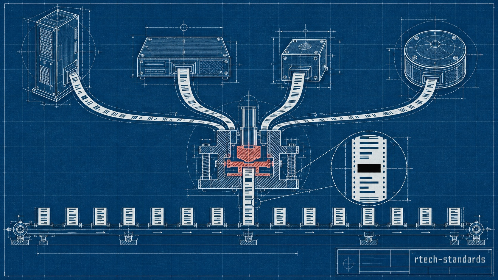
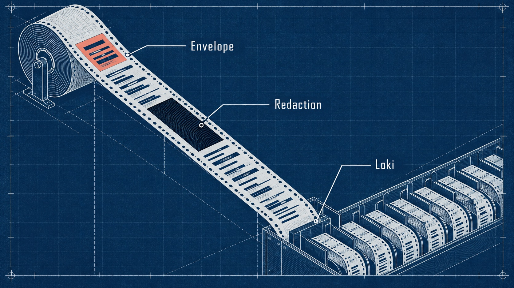
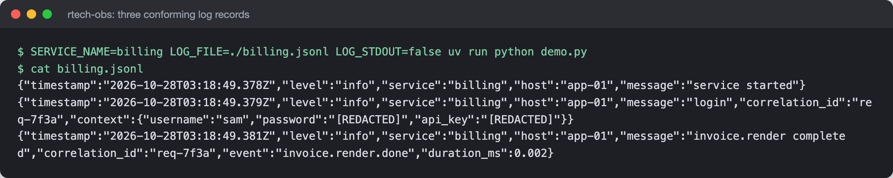

# rtech-standards

One JSON log format for every service, whatever language it is written in:
a versioned spec, a conformance fixture that proves an implementation
follows it, and a Python reference package.




## What it is

- `OBSERVABILITY_CONTRACT.md` is the normative, semver'd spec for every log
  line a service emits: fields, levels, labels, redaction, configuration
  and file paths.
- `conformance/envelope-cases.json` is a language-agnostic set of test
  vectors. An implementation conforms when it passes every case.
- `packages/python/` (`rtech-obs`) is the reference implementation, built
  on loguru.
- `docs/decisions.md` records each design decision and the reason for it.

## Why it exists

The services this was written for had no log ingestion: they wrote to
journald or nowhere, and the Ansible runs that changed them left no record.
"What broke at 03:14, and what changed it" had no answer because the data
was never written. Application logs and infrastructure run records need one
shared envelope to land on one queryable timeline, and nine repositories
each writing their own logger would drift. One versioned package they all
import does not.

## How it works



Every record is a single-line JSON object. Five required fields
(`timestamp`, `level`, `service`, `host`, `message`) are stamped by the
package, never by the caller, so service names cannot be spelled five ways.
Optional fields are `correlation_id`, `event`, `error`, `duration_ms` and
`context`; any other key is moved into `context`. Exactly two fields,
`service` and `host`, become Loki labels, because each extra label value
creates a new index stream and a high-cardinality label would make Loki
unusable. Secret-looking keys keep their name and have the value replaced
with `[REDACTED]`, recursively. Configuration is read once at start-up into
a frozen object: a missing `SERVICE_NAME` or bad `LOG_LEVEL` fails closed,
while an unwritable log file falls back to stdout with one loud warning.

Three records written by the Python package (real output; the capture
script sets the host name to `app-01` so no machine name is published):



## Features

- Contract with RFC 2119 language and semver rules for wire changes
- Shared conformance fixture, with volatile fields matched by pattern
- Python package exporting `init_observability`, `logger`, `with_context`
  and `with_logging` (entry, exit and failure records with `duration_ms`)
- Recursive key-preserving redaction
- Background-thread file writes; the package README records about 50 µs
  per record measured on an M4 Pro
- CI and a pre-push hook that run the same checks: fixture validity,
  contract/fixture version match, ruff, strict mypy, pytest (run as an
  unprivileged user so permission tests are real), and PR test selection
  by changed path

## Stack

Python 3.13, loguru, uv, pytest, ruff, mypy (strict). CI is a GitHub
Actions-compatible workflow written for Forgejo Actions.

## Run it locally (for review)

```sh
cd packages/python
uv sync
uv run pytest          # 18 tests, the conformance fixture is the gate
uv run ruff check .
uv run mypy src
```

Free for personal and non-commercial use with credit; commercial use needs
a licence. See [LICENSE](LICENSE) (PolyForm Noncommercial 1.0.0).

## Project status

Contract 1.0.0 and the Python package (1.0.0) pass the fixture. No other
language binding is implemented yet; Rust and Swift are deliberately
spec-only until something imports them. A metrics extension (Prometheus,
contract 1.1-1.2) was written and tested on a separate branch and is not
part of this release. The CI workflow was written for a self-hosted Forgejo
runner; the `runs-on` and container lines were adapted for this snapshot
and have not been run on GitHub.

## How it was built

Written over one night and morning (2026-07-25, 01:18 to 10:45), starting
from the decision that a shared package beats a standards document. The
pre-push hook failed its own first run, and failing tests, not code reading,
found two silent bugs in the (unmerged) metrics work. The full story
is in [docs/BUILD-STORY.md](docs/BUILD-STORY.md).

## Credits

- [loguru](https://github.com/Delgan/loguru), the logging library the
  Python package builds on.
- [Grafana Loki](https://grafana.com/oss/loki/), whose label model drives
  the two-label rule.

## Author

Rico Rojas, https://rico-rojas.com
